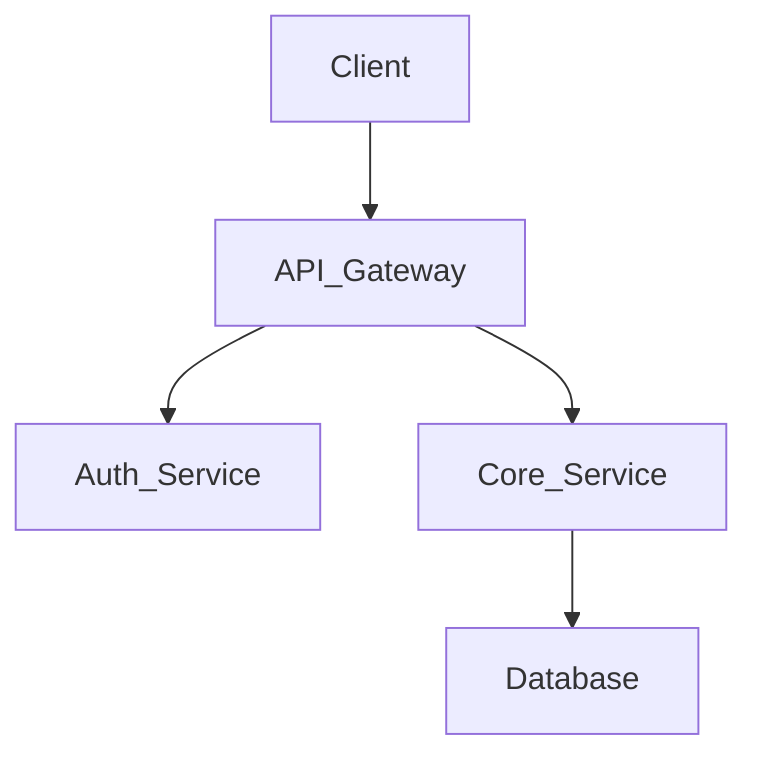

# 🏗️ Hồ Sơ Thiết Kế Kiến Trúc (ADR) & Kiến Trúc Hệ Thống

## 1. Tổng Quan Hệ Thống
*(Mô tả tổng quan về hệ thống, chức năng chính và cách các luồng dữ liệu di chuyển)*

## 2. Sơ Đồ Thành Phần
*(Thêm sơ đồ Mermaid hoặc chèn hình ảnh kiến trúc hệ thống)*

## 3. Công Nghệ Sử Dụng
- **Giao Diện (Frontend):** [VD: React, Vite, TailwindCSS, Zustand]
- **Máy Chủ (Backend):** [VD: Spring Boot, Java 17, Spring Security]
- **Cơ Sở Dữ Liệu (Database):** [VD: MySQL, Redis cho Caching]
- **Hạ Tầng (Infrastructure):** [VD: Docker, GitHub Actions, AWS/Vercel]

## 4. Các Quyết Định Thiết Kế
### 4.1. [Tên quyết định, VD: Chọn JWT cho Xác Thực]
- **Bối Cảnh:** Tại sao cần đưa ra quyết định này?
- **Quyết Định:** Chúng ta chọn công nghệ/giải pháp gì?
- **Hệ Quả:** Ưu điểm và nhược điểm của giải pháp là gì?

## 5. Chiến Lược Dữ Liệu & Giao Tiếp
- **Kiểu Giao Tiếp:** RESTful / GraphQL
- **Xác Thực:** Bearer Token (JWT), OAuth2
- **Mô Hình Dữ Liệu:** Cách tổ chức Schema, Indexing.

## 6. Kiến Trúc Triển Khai
- **Môi Trường:** Cục bộ (Local), Kiểm thử (Staging), Thực tế (Production).
- **Quy Trình Tự Động (CI/CD):** Mô tả các bước build, test và deploy tự động.
